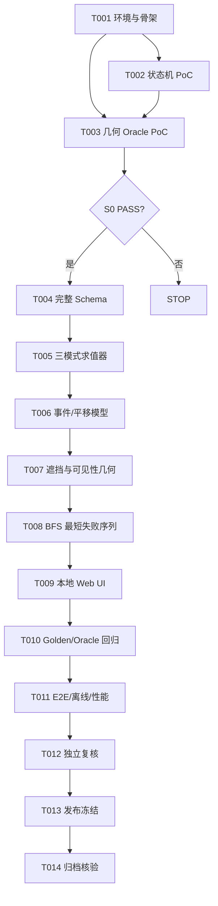

# P021 ViewportShift｜实施计划书

**PROJECT_ID:** `P021`  
**SLUG:** `viewportshift`  
**SPEC_VERSION:** `1.0.0`  
**计划状态:** `READY_FOR_S0_ONLY / NO_CODE_BUILT`  
**权威产品契约:** `PROJECT_BOOK.md` 1.0.0  
**许可证:** `PENDING_SAM_DECISION`

> 本计划中的命令、PASS 数量、性能目标和工时是验收门槛/估算，不是已执行结果。当前只允许 T001–T003 的 S0 前置验证；S0 PASS 前 T004–T014 不得启动。

## 0. 阶段编号与硬门

- **S0：开工前置硬门（T001–T003）**。S0 失败即 STOP；不通过不得启动 T004–T014。
- **S1：契约与核心状态机（T004–T006）**。
- **S2：事件与几何内核（T007–T008）**。
- **S3：最短见证与 UI（T009–T010）**。
- **S4：完整自动化验证（T011–T012）**。
- **S5：独立复核与发布冻结（T013–T014）**。

### 0.1 S0 全部通过条件

1. 48 个确定性场景（4 布局 × 3 键盘行为 × 4 事件序列）与独立几何 Oracle 全对。
2. 12 个预植入遮挡/定位错误 12/12 检出。
3. 正常场景误报 0。
4. 遮挡面积、底部间距及所有约定几何字段与 Oracle 逐字段一致。
5. 固定输入连续运行 100 次，只有 1 个规范化 SHA-256。
6. 固定 seed 重放完全一致。
7. 不支持行为 fail-closed 为 UNKNOWN；不得假 PASS。
8. 全部测试使用合成数据、无真人、无真实设备、无外部 API/LLM/GPU。

任一项失败：`S0_GATE.json.status = FAIL`，T004–T014 全部 BLOCKED。只允许修复 T001–T003 的 S0 验证代码/PoC；不得删 fixture、改预期值、增加忽略字段或降低阈值。核心模型无法成立则 STOP。

## 1. 不可变工程决策

1. 前端固定 TypeScript + React + SVG。
2. 独立 Python Geometry Oracle；不得导入生产 TS 模块。
3. 固定 seed、确定性事件重放、规范化 JSON 和稳定排序。
4. 本地优先；运行时零网络、零 LLM/API、零遥测。
5. 零真人参与；所有 fixture 均为合成数据。
6. 三种标准视口模式固定为 `resizes-visual`、`resizes-content`、`overlays-content`。
7. 延迟视觉视口平移是压力事件，不是第四种模式。
8. 核心几何使用定点数；禁止浮点容差掩盖 mismatch。
9. 任一字段 mismatch 即 FAIL；无忽略清单、无人工豁免。
10. Oracle parity 100%；100 次运行必须 1 个哈希。
11. 不连接真实手机，不将模拟模型宣称为真实浏览器认证。
12. 项目许可证 `PENDING_SAM_DECISION`；Sam 决定前不得公开再分发。
13. Muse 只负责调度、门禁、验收、归档，不写业务代码/测试脚本。
14. 每个编码、修复、集成和审查任务均用全新模型会话；构建者与审查者尽可能不同。

## 2. 工作区布局

```text
P021-viewportshift/
  PROJECT_BOOK.md
  IMPLEMENTATION_PLAN.md
  package.json / package-lock.json / tsconfig.json / vite.config.ts
  README.md / LICENSE_STATUS.md / THIRD_PARTY_NOTICES.md
  src/
    domain/       # schema, state-machine, replay, geometry, bfs, canonical
    ui/           # React 页面与交互
    render/       # SVG viewport/keyboard/surface 绘制
    io/           # JSON import/export, report
  oracle/python/ # 独立几何 Reference Oracle
  tests/
    fixtures/s0/ # 48 场景与预植入错误
    golden/ mutations/ properties/ e2e/
  scripts/       # env, oracle-diff, determinism, release verify
  evidence/
    environment/ s0/ tests/ e2e/ offline/ performance/ review/ release/
  handoff/T001...T014/
  release/ source.zip dist.zip SHA256SUMS.txt RELEASE_MANIFEST.json
```

## 3. 阶段与依赖图

| 阶段 | 任务 | 交付 | 退出门槛 |
|---|---|---|---|
| S0 | T001–T003 | 环境、状态机 PoC、几何 Oracle PoC、48 场景门禁 | 48/48 parity、12/12 检出、0 误报、100 次 1 hash |
| S1 | T004–T006 | Schema、正式状态机、差分 Gate | 合同冻结、模式转移 parity 100% |
| S2 | T007–T008 | 延迟平移/滚动事件、几何内核 | 每字段 Oracle parity 100% |
| S3 | T009–T010 | BFS 最短见证、React/SVG UI 与 JSON 导出 | 最短序列正确、离线演示可运行 |
| S4 | T011–T012 | Golden/变异/属性/E2E/离线/性能 | 0 mismatch、0 false PASS、发布预演通过 |
| S5 | T013–T014 | 独立复核、冻结包 | 独立审查 PASS、哈希/清单闭合 |



## 4. 任务卡通用合同

每个 TASK 包含 TASK_ID、目标、输入、允许/禁止修改文件、输出路径、验收命令、预期日志、失败回退和完成定义。每个任务使用新会话与独立工作目录；先验收再合并。统一交接：

```text
handoff/Txxx/
  TASK_REPORT.md
  changed_files.txt
  test_commands.txt
  test_logs/
  screenshots/       # UI 任务
  sha256.txt
  unresolved_items.md
```

任何命令不得用空脚本或固定 `exit 0` 冒充通过。未通过任务不得合并。实际 VM OS/版本由 T001 记录，不预设已安装环境。

## 5. T001–T014 原子任务卡

### T001 — 环境与工程骨架（S0，3h）
- **目标：** 盘点 VM OS/CPU/RAM/磁盘/Node/Python/Git/浏览器，建立最小 TS/React/Vite 与 Python Oracle 骨架。
- **输入：** 本书、实施计划、当前 VM；无真实设备数据。
- **输出：** `evidence/environment/ENVIRONMENT_REPORT.md`、`package.json`、lockfile、`scripts/env-check.mjs`、Oracle 空骨架。
- **禁止：** 不实现业务算法、不改 fixtures/规格。
- **验收命令：** `node --version`；`npm --version`；`python --version`；`git --version`；`npm ci`；`npm run env:check`；`npm run typecheck`。
- **通过标准：** 记录真实环境；安装/类型检查退出码 0；无 GPU、Docker、手机或 API 前置条件；环境指纹与报告哈希可复算。
- **失败回退：** 只修骨架/环境探测；无法使用现有环境时 S0 BLOCKED。

### T002 — 三模式视口状态机 PoC（S0，4h）
- **目标：** 最小实现三种标准模式及键盘开/关、滚动、settled 转移；验证布局/视觉视口状态关系。
- **输入：** T001 骨架、三种模式契约、合成事件序列。
- **输出：** `src/domain/viewport-state.ts`、8 个模式转移 PoC、`evidence/s0/T002_REPORT.md`。
- **禁止：** 不做 UI、不做真实浏览器接入、不改 Oracle expected。
- **验收命令：** `npm run s0:state-machine`；`npm run typecheck`。
- **通过标准：** 三模式差异按契约呈现；相同输入轨迹逐字段一致；不支持行为返回 UNKNOWN；无 wall clock/timer 依赖。
- **失败回退：** 修复状态机 PoC；无法区分三模式则 S0 FAIL/STOP。

### T003 — 几何 Oracle PoC 与 S0 Gate（S0，5h）
- **目标：** 实现 TS 矩形几何与独立 Python Oracle；运行 48 场景、12 个植入错误、0 误报、100 次哈希。
- **输入：** T001–T002、固定 seed `P021-VIEWPORTSHIFT-S0-2026-11-10`、4 布局 × 3 键盘行为 × 4 事件序列。
- **输出：** `oracle/python/geometry_oracle.py`、`tests/fixtures/s0/`、`scripts/s0-gate.mjs`、`evidence/s0/S0_GATE.json` 与日志。
- **禁止：** 不得删场景、放宽几何阈值、忽略字段或由 TS 生成 Oracle 期望值。
- **验收命令：** `npm run s0:geometry`；`npm run s0:oracle`；`npm run s0:determinism`；`npm run s0:gate`。
- **通过标准：** 48/48 Oracle parity；12/12 错误检出；正常场景误报 0；遮挡面积/底部间距及全部指标逐字段一致；100 次只有 1 hash；固定 seed 完全重放一致。
- **失败回退：** 修复 T003；若核心几何定义无法独立复算则 STOP。S0 PASS 前 T004–T014 不得启动。

### T004 — Schema 与输入验证（S1，4h）
- **目标：** 冻结 `viewportshift.scenario/v1`、布局、事件、视口、键盘、谓词、限制和结果 Schema。
- **输入：** S0 PASS、项目书第 6 节。
- **输出：** `src/domain/types.ts`、`validate.ts`、Schema fixtures。
- **验收命令：** `npm run test:schema`；`npm run test:validation`。
- **通过标准：** 缺字段、非法单位、负尺寸、时间倒退、超限事件、非 1 scale 均按 INVALID/UNKNOWN 规定处理；错误码稳定。
- **禁止：** 不改 S0 golden/Oracle；不隐式单位换算。

### T005 — 三种视口模式正式求值器（S1，5h）
- **目标：** 完成 `resizes-visual`、`resizes-content`、`overlays-content` 状态转移纯函数。
- **输入：** T004 Schema、T002 PoC。
- **输出：** `src/domain/modes.ts`、模式边界 fixtures。
- **验收命令：** `npm run test:modes`；`npm run oracle:diff:modes`。
- **通过标准：** 每种模式至少有正例/负例/边界例；Oracle parity 100%；unsupported UNKNOWN。
- **禁止：** 不把延迟平移合并成第四模式。

### T006 — 延迟平移与滚动事件模型（S1，4h）
- **目标：** 实现 `DELAYED_VISUAL_PAN`、滚动、键盘开关和 settled 事件的确定性时序与 clamp。
- **输入：** T004 Schema、T005 状态机。
- **输出：** `src/domain/events.ts`、事件轨迹 fixtures、clamp 证据。
- **验收命令：** `npm run test:events`；`npm run test:event-order`；`npm run oracle:diff:events`。
- **通过标准：** 固定时间戳/顺序可重复；requested/applied pan 可核对；夹紧边界正确；无系统时钟依赖。
- **禁止：** 不使用真实浏览器动画/计时器。

### T007 — 遮挡与可见性几何计算（S2，6h）
- **目标：** 完成矩形交集、键盘遮挡、viewport clipping、可见面积/比例、bottomGap、anchorDrift。
- **输入：** T005–T006、Python Oracle PoC。
- **输出：** `src/domain/geometry.ts`、Python 独立 Oracle 完整实现、逐字段差分报告。
- **验收命令：** `npm run test:geometry`；`npm run oracle:diff:geometry`。
- **通过标准：** 所有几何字段逐字段完全一致；任一 mismatch fail；零面积 INVALID；重叠区域不重复扣除。
- **禁止：** 不使用容差忽略 mismatch；不复用 TS 实现。

### T008 — 最短失败序列搜索（S2，5h）
- **目标：** 有界 BFS 搜索首个遮挡/定位谓词失败的最短事件序列。
- **输入：** T005–T007、固定事件字母表与离散参数集合。
- **输出：** `src/domain/bfs.ts`、witness fixtures、搜索边界报告。
- **验收命令：** `npm run test:bfs`；`npm run test:bfs:determinism`。
- **通过标准：** 预植入最短 witness 与 golden 一致；同长度按冻结顺序唯一；上限耗尽返回 BOUNDED_NO_WITNESS；不将不同可观察状态错误去重。
- **禁止：** 不无限扩张事件字母表/搜索深度。

### T009 — 本地 Web UI 与 SVG 时间轴（S3，8h）
- **目标：** 实现选布局、选模式、事件编辑/重放、SVG 几何视图、时间轴、指标与 witness 展示。
- **输入：** T004–T008 稳定 domain API。
- **输出：** `src/ui/**`、`src/render/**`、截图、UI 报告。
- **验收命令：** `npm run typecheck`；`npm run build`；`npm run test:ui`。
- **通过标准：** 三 UI 模板可视化；事件选择同步显示状态；CSS px 明确；UNKNOWN/FAIL/PASS 文字可见；键盘可操作。
- **禁止：** UI 不实现第二套算法，不连接真实网页/手机。

### T010 — JSON 导入导出与离线报告（S3，5h）
- **目标：** 完成场景/结果 JSON 导入导出、自包含离线 HTML 报告和 Demo。
- **输入：** T009 UI、正式 Schema。
- **输出：** `src/io/**`、报告模板、README Quick Start。
- **验收命令：** `npm run build`；`node dist/viewportshift.mjs demo`；`npm run test:export`。
- **通过标准：** Demo 只用合成数据；JSON 可 round-trip；HTML 无 CDN/远程资源；导出 hash 可复算。
- **禁止：** 不上传数据、不加入自动云同步。

### T011 — Golden/变异/属性/Oracle 差分测试（S4，7h）
- **目标：** 扩充 Golden 与边界/变异样本，覆盖三模式、延迟平移、几何和 BFS。
- **输入：** T004–T010 已合并版本、固定 seed。
- **输出：** `tests/fixtures/golden/`、`mutations/`、`properties/`、`ORACLE_PARITY_REPORT.json`。
- **验收命令：** `npm test`；`npm run test:property -- --seed P021-VIEWPORTSHIFT-S0-2026-11-10`；`npm run test:oracle`；`npm run test:mutation`。
- **通过标准：** S0 48/48 持续通过；Oracle parity 100%；12/12 植入错误检出；正常误报 0；所有支持语义有正负边界样本；unsupported 不假 PASS。
- **禁止：** 不生成 ignore list，不改预期值迎合实现。

### T012 — E2E/离线/性能/发布预演（S4，5h）
- **目标：** 走通 UI 主流程，验证离线、导出、性能和重复构建。
- **输入：** T011 PASS。
- **输出：** Playwright traces、截图、offline/performance 报告、发布预演包。
- **验收命令：** `npm run test:e2e`；`npm run test:offline`；`npm run test:performance`；`npm run build`；`npm run release:verify`。
- **通过标准：** 选择布局→模式→重放→时间轴→导出全链路通过；外部网络请求 0；性能门槛由 T001 环境记录后冻结；两次构建 hash 一致；Windows 未实测则 NOT_TESTED。
- **禁止：** 不把模拟模型宣称为真机兼容性。

### T013 — 独立复核（S5，7h；必须不同模型/新会话）
- **目标：** 独立检查关键源文件、Oracle、测试、隐私、边界、UI 和发布证据。
- **输入：** 冻结候选 commit、`REVIEW_INDEX.md`、分批 `REVIEW_PACK_XX.md`、全部测试日志和源码。
- **输出：** `INDEPENDENT_REVIEW.md`、`COVERAGE_MATRIX.csv`、`REVIEW_INDEX.md`、分批审查包。
- **验收命令：** `npm ci`；`npm run typecheck`；`npm test`；`npm run test:oracle`；`npm run test:e2e`；`npm run test:offline`；`npm run release:verify`。
- **通过标准：** P0/P1 = 0；Oracle parity 100%；false PASS = 0；源文件覆盖率 100%；每个文件标记 READ/NOT_READ；审查者与构建者不同会话；不能读取的证据明确列出。
- **禁止：** 审查者不得直接修复；发现问题另开新修复任务并重审。

### T014 — 发布冻结与 SHA-256 清单（S5，4h）
- **目标：** 冻结 source.zip、dist.zip、SHA256SUMS.txt、RELEASE_MANIFEST.json。
- **输入：** T013 PASS、最终 commit、全部日志/清单。
- **输出：** `release/source.zip`、`dist.zip`、`SHA256SUMS.txt`、`RELEASE_MANIFEST.json`、`T014_FREEZE_REPORT.md`。
- **验收命令：** `npm run release:freeze`；`npm run release:verify`；`python scripts/deterministic_zip.py --verify release/source.zip`；`python scripts/deterministic_zip.py --verify release/dist.zip`。
- **通过标准：** ZIP 可解压；文件清单完整；重复构建一致；manifest 对应最终 commit、Oracle 报告、T013 审查；哈希可独立重算；冻结后工作树 clean。
- **禁止：** 不添加未经 Sam 决定的 LICENSE；冻结后任何变更必须新 commit、新 T013、新 T014。

## 6. Oracle、确定性与哈希合同

### 6.1 Oracle 独立性

Python Oracle 与 TypeScript 生产实现分别实现状态转移与矩形几何；不共享算法模块、不相互调用。仅共享只读 fixture、字段名和规范化协议。比较字段至少包含状态、layout/visual viewport、keyboard rect、surface rect、obscured area、clipped area、visible area/ratio、bottomGap、anchorDrift、witness sequence。**任一字段 mismatch 即 FAIL；无忽略清单、无人工豁免。**

### 6.2 固定 seed 与确定性

固定 seed：`P021-VIEWPORTSHIFT-S0-2026-11-10`。禁止当前时间、随机 UUID、机器绝对路径进入 canonical result。事件按固定顺序处理；搜索 tie-breaker 固定；所有数组排序规则冻结。

### 6.3 哈希合同

- `scenario_sha256`：规范化场景输入。
- `oracle_result_sha256`：Python Oracle 规范化结果。
- `analysis_sha256`：移除自身哈希字段后的规范化结果。
- `gate_sha256`：S0_GATE 报告规范化哈希。
- `source.zip` / `dist.zip`：固定条目排序、时间戳、权限、压缩参数。

固定输入重复运行 100 次必须得到 1 个唯一分析哈希。所有哈希由独立命令复算。无 ignore list，无字段豁免，无容差掩盖 mismatch。

## 7. 模型工种、并发与交接

Muse 按其已实测可用的免费模型平台清单分工，不预设模型名称或额度。建议工种：环境/骨架、状态机、几何 Oracle、事件模型、BFS、UI、测试、独立审查、发布。每任务新会话；构建者与 T013 审查者不同；不同任务文件所有权隔离；Muse 负责门禁和归档，不写业务代码。

## 8. 风险分级与停止策略

| 级别 | 风险 | 处理 |
|---|---|---|
| P0 | 三模式无法正确建模；Oracle mismatch；植入错误漏检；正常场景误报；false PASS | 立即 FAIL/STOP；不进入下游 |
| P1 | BFS 过大、未知行为被误判、事件时序定义歧义、UI 状态误导 | 修复或 fail-closed UNKNOWN；独立复核 |
| P2 | 小屏排版、动画、次要 SVG 美化、性能非核心退化 | 登记；不扩大防御工程 |
| P3 | 未来浏览器模式/复杂 transform/真机集成请求 | 明确 UNKNOWN 或路线图，不纳入 MVP |

**强制 STOP：** 模拟模型无法用三种视口模式验证关键差异；退化成普通键盘演示页；退化成普通 CSS 修复；核心价值依赖真实手机/真人/收费 API；独立 Oracle 无法成立。不得通过扩大范围绕过停止条件。

## 9. 工时估算（88h 总口径）

| 阶段 | 任务 | 基准工时 |
|---|---|---:|
| S0 | T001–T003 | 12h |
| S1 | T004–T006 | 13h |
| S2 | T007–T008 | 11h |
| S3 | T009–T010 | 13h |
| S4 | T011–T012 | 12h |
| S5 | T013–T014 | 11h |
| **基准总计** | T001–T014 | **72h** |
| 缓冲 | 用于一次核心修复、跨平台差异与文档/打包返工 | **16h** |
| **总预算** | 基准 + 缓冲 | **88h** |
| **总预算** | 对齐 P020 容量口径 | **88h** |

任务卡估算合计为 **72h**：T001 3 + T002 4 + T003 5 + T004 4 + T005 5 + T006 4 + T007 6 + T008 5 + T009 8 + T010 5 + T011 7 + T012 5 + T013 7 + T014 4 = 72h。另留 **16h 缓冲**，总预算 **88h**，与 P020 容量口径一致。以上为计划估算，不是已消耗工时。

## 10. 交付结构与发布清单

```text
P021-viewportshift/
  00_spec/ PROJECT_BOOK.md PROJECT_BOOK.docx IMPLEMENTATION_PLAN.md IMPLEMENTATION_PLAN.docx
  00_control/ TASK_BOARD.csv ENVIRONMENT_REPORT.md S0_GATE.json DECISION_LOG.md
  01_source/ src/ oracle/ tests/ scripts/ README.md package-lock.json
  02_tasks/ T001...T014/ handoff/
  03_tests/ golden/ mutations/ properties/ e2e/ logs/
  04_reviews/ REVIEW_INDEX.md REVIEW_PACK_XX.md COVERAGE_MATRIX.csv INDEPENDENT_REVIEW.md
  05_evidence/ screenshots/ reports/ hashes/ environment/
  06_release/ source.zip dist.zip SHA256SUMS.txt RELEASE_MANIFEST.json RELEASE_NOTES.md
```

发布前检查：
- [ ] S0_GATE PASS 且哈希可复算。
- [ ] 48 场景 Oracle parity 100%。
- [ ] 12/12 植入错误检出、正常误报 0。
- [ ] 100 次运行 1 个哈希，固定 seed 完全一致。
- [ ] 所有支持语义有 Golden/负例/边界例。
- [ ] unsupported 均 UNKNOWN，无 false PASS。
- [ ] UI 主流程、JSON 导出、离线报告可运行。
- [ ] Windows 状态如实标记；未实测不得写 PASS。
- [ ] T013 独立复核 PASS，文件覆盖逐项可核对。
- [ ] source/dist/manifest/SHA 清单闭合。
- [ ] LICENSE 状态 `PENDING_SAM_DECISION`；未擅自公开。

**当前授权：仅 S0（T001–T003）。S0 PASS 前不得开始 T004–T014。规格冻结不等于 GO、施工开始或验收通过。**
